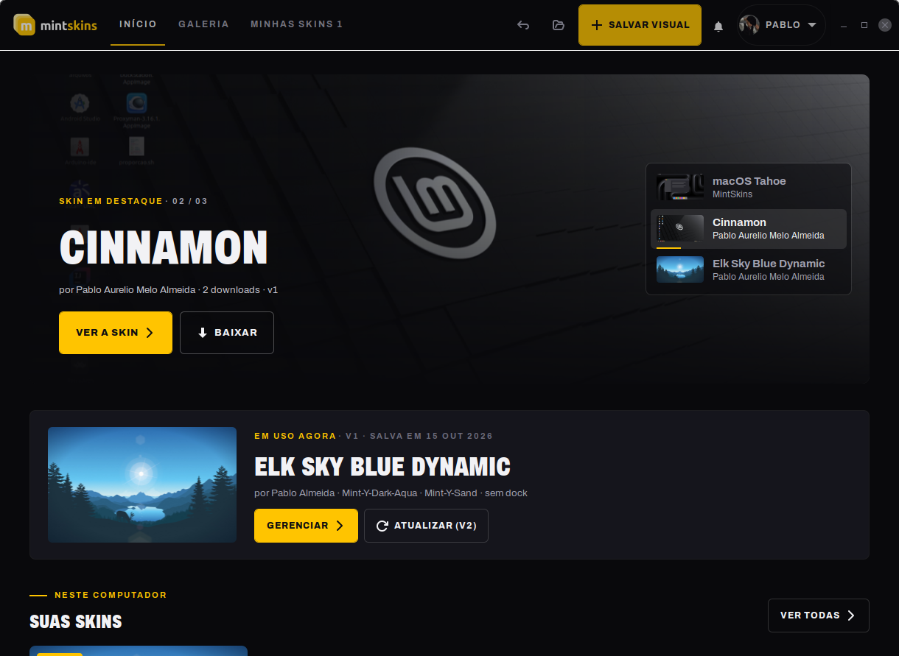
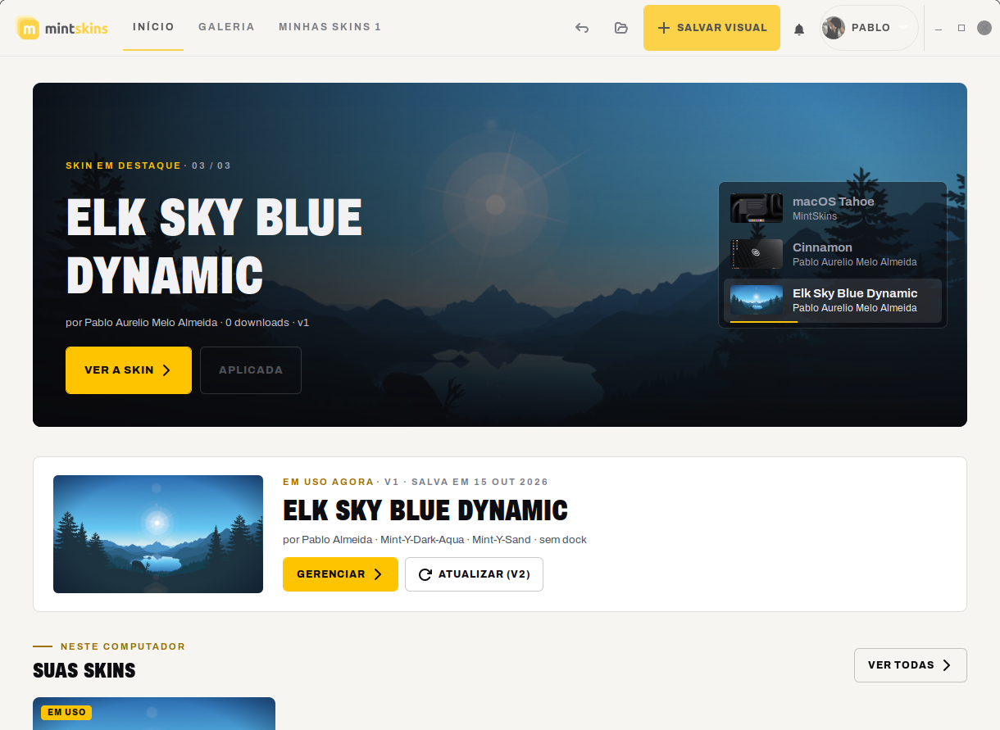
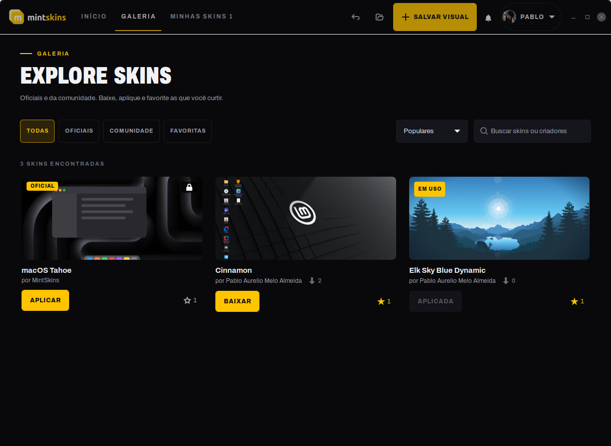
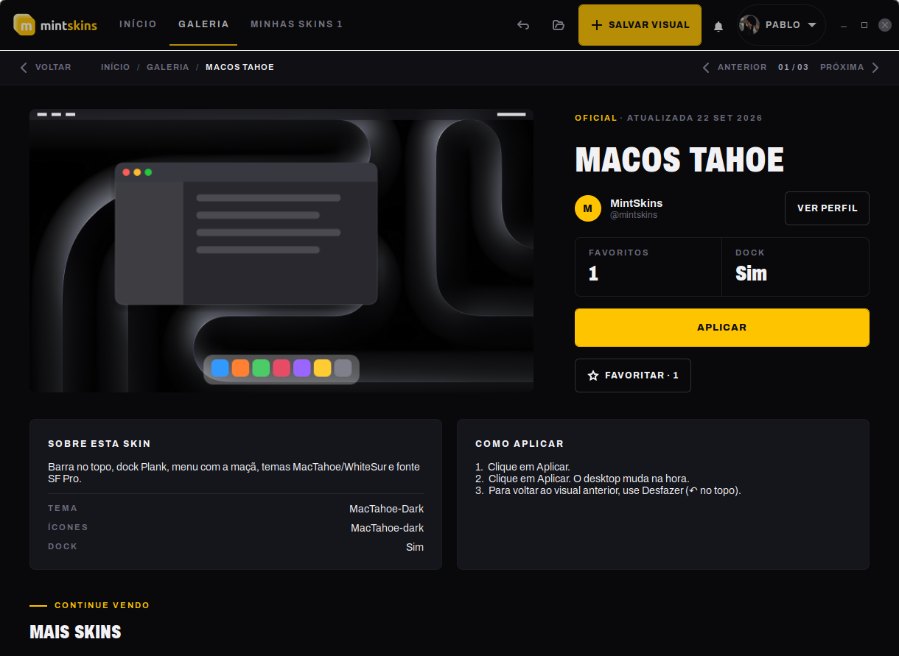
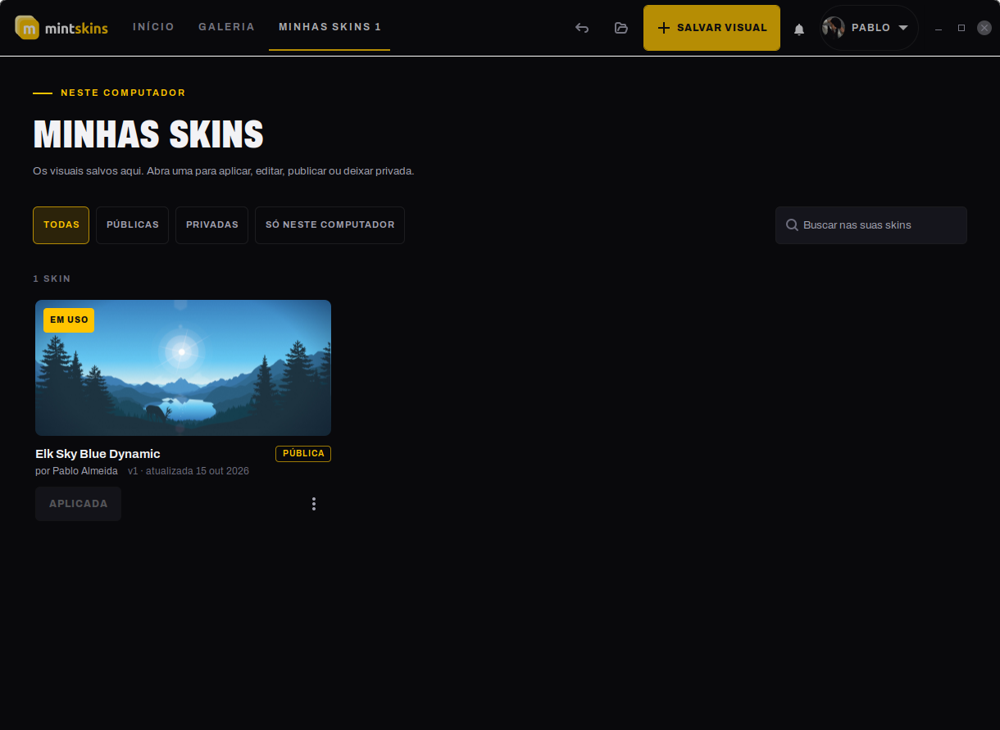
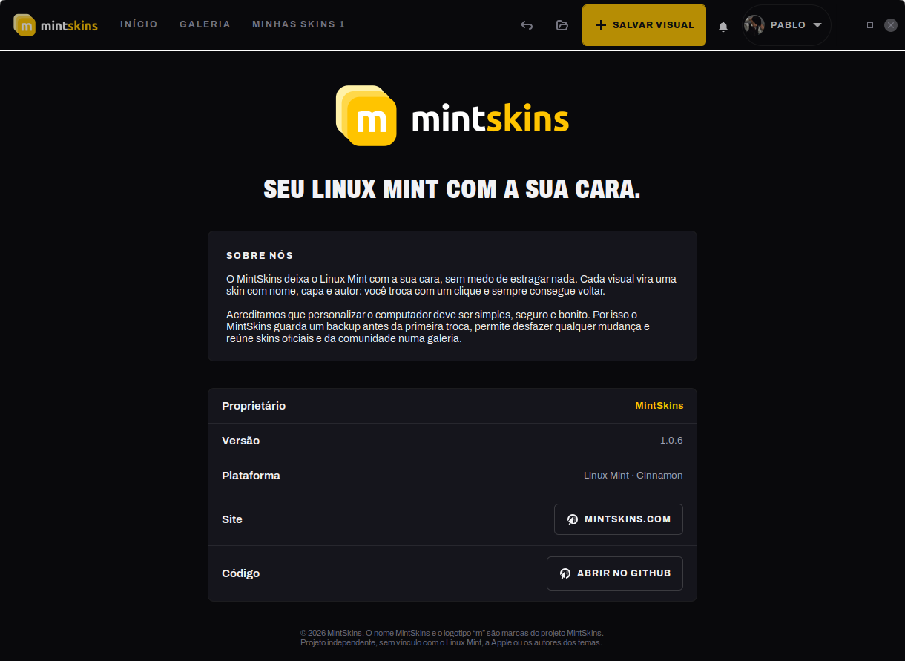

<p align="center">
  <picture>
    <source media="(prefers-color-scheme: dark)" srcset="mintskins/ui/marca/logo-escuro.svg">
    
  </picture>
</p>

<p align="center"><strong>Troque o visual do seu Linux Mint Cinnamon com um clique.</strong></p>

<p align="center">
  <a href="https://github.com/MintSkins/MintSkins/releases"></a>
  
  
  
</p>

O MintSkins guarda o visual do desktop como **skins**, cada uma com nome, capa e
autor. Salve quantas quiser, troque entre elas e sempre volte para a anterior.

<p align="center">
  
</p>

<table>
  <tr>
    <td align="center" width="50%">
      <br>
      <sub><b>Início</b> · tema claro</sub>
    </td>
    <td align="center" width="50%">
      <br>
      <sub><b>Galeria</b> · oficiais e da comunidade</sub>
    </td>
  </tr>
  <tr>
    <td align="center">
      <br>
      <sub><b>Sua skin</b> · versões, pública ou privada</sub>
    </td>
    <td align="center">
      <br>
      <sub><b>Skin da galeria</b> · anterior e próxima</sub>
    </td>
  </tr>
  <tr>
    <td align="center">
      <br>
      <sub><b>Minhas skins</b> · filtros por onde a skin está</sub>
    </td>
    <td align="center">
      <br>
      <sub><b>Sobre</b> · marca e proprietário</sub>
    </td>
  </tr>
</table>

## Recursos

- **Mesma cara do mintskins.com**: menu no topo, vitrine de destaques, títulos
  grandes e botões iguais aos do site, nos temas claro e escuro
- **Skin oficial macOS Tahoe** incluída: barra no topo, dock e menu com a maçã
- **Versões**: mudou algo no desktop? Salve na skin em uso e ela vira a v2, v3…
  Escolha a capa (foto da tela, imagem sua ou a mesma) e envie junto para a conta
- **Página de cada skin**: deixe só no computador, privada na conta ou pública
  na galeria, e veja se há mudanças ainda não enviadas
- **Galeria** com skins oficiais e da comunidade: veja os detalhes, o perfil do
  autor, baixe e favorite
- **Conta do mintskins.com**: entre com o e-mail (ou @usuario) e a senha do site,
  envie suas skins (públicas ou privadas), baixe as da comunidade e edite seu
  perfil (e-mail e senha mudam pelo site)
- **Backup obrigatório** antes da primeira troca e **desfazer** a qualquer hora
- **Atualização automática**: avisa quando sai uma versão nova e instala com um clique
- Exporte e importe skins (`.mintskins`) para usar em outros computadores

## Instalar

Baixe o `.deb` mais recente em
[Releases](https://github.com/MintSkins/MintSkins/releases) e instale:

```bash
sudo apt install ./mintskins_*_all.deb
```

Depois abra **MintSkins** no menu. Requisitos: Linux Mint com Cinnamon. O `apt`
instala o resto, inclusive o dock Plank.

## Usando

| Quero… | Onde |
|---|---|
| Guardar o visual atual | **Salvar visual**, no topo |
| Guardar mudanças na skin em uso (nova versão) | **Salvar visual** → **Atualizar**, ou **Salvar alterações** na página da skin |
| Trocar de visual | **Aplicar** no card da skin |
| Voltar ao visual anterior | seta ↶ no topo, ou **Desfazer** no aviso |
| Baixar skins | **Galeria** → **Baixar** |
| Ver quem fez uma skin | clique no nome do autor |
| Guardar ou publicar uma skin minha | **Minhas skins** → abra a skin → **Onde esta skin fica** |
| Andar entre as skins | **Anterior** / **Próxima** no topo da skin, ou ← → |
| Favoritar | estrela no card (precisa entrar na conta) |
| Trocar papel de parede, tela de login, tema do app | **Preferências** |

As skins oficiais não podem ser editadas. Para mudar uma delas, use
**Duplicar**: a cópia é sua.

## O que uma skin guarda

Tema, ícones, cursor, fontes, borda das janelas, painel com todos os applets e
suas configurações, extensões, dock, papel de parede, tela de bloqueio e atalhos
de teclado. Temas, ícones e fontes instalados na sua pasta pessoal vão dentro da
skin, então ela funciona em outro computador.

Ficam de fora: ícones da área de trabalho, preferências do Nemo, mouse e
áreas de trabalho.

## Linha de comando

```bash
mintskins listar
mintskins aplicar macos
mintskins salvar "Meu tema"
mintskins desfazer
mintskins atualizar
mintskins exportar macos ~/macos.mintskins
mintskins importar ~/macos.mintskins
```

## Desenvolvimento

```bash
./bin/mintskins                            # roda sem instalar
./build-deb.sh                            # gera dist/mintskins_<versão>_all.deb
./scripts/lancar-versao.sh 1.1.0          # publica uma versão nova
```
